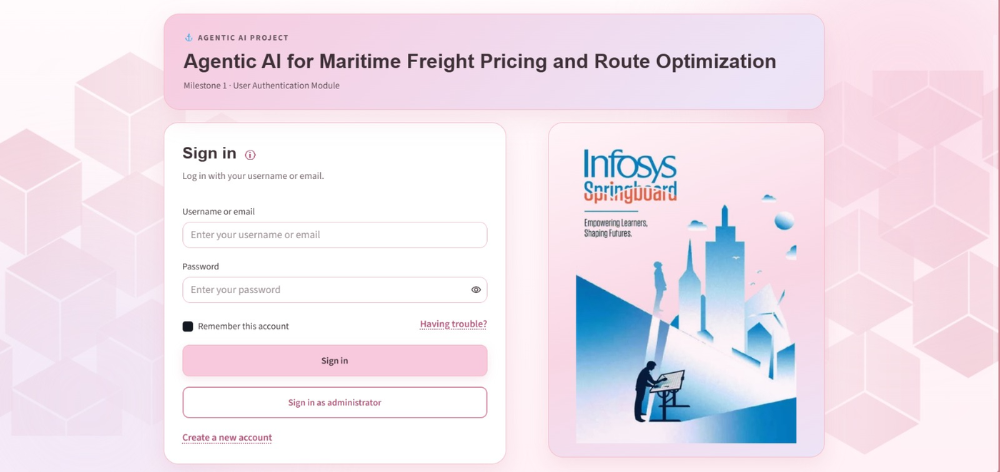
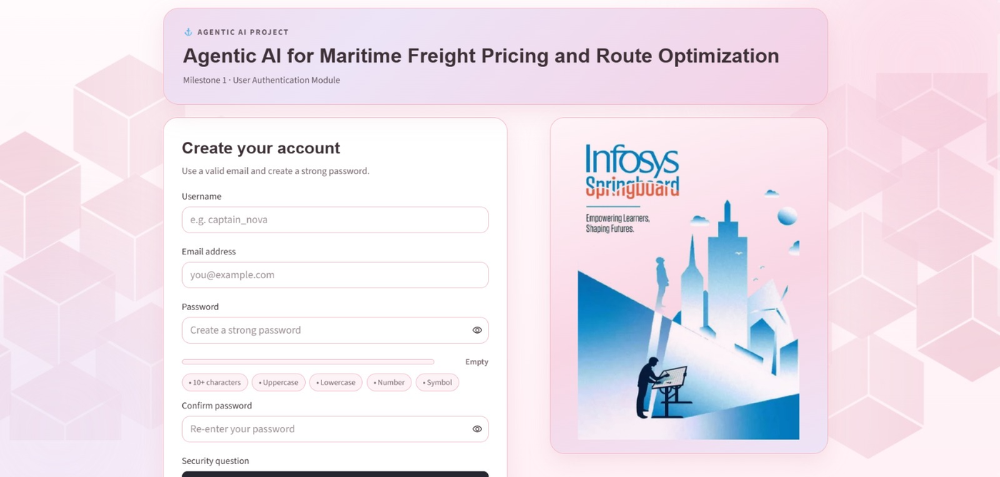
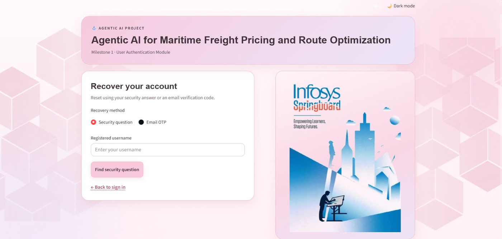
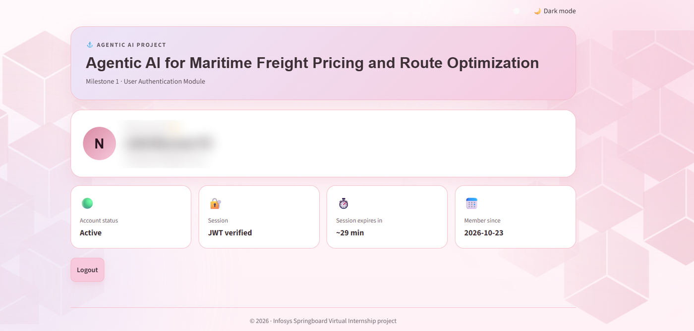

# 🔐 Secure Authentication Portal

### Agentic AI for Maritime Freight Pricing and Route Optimization
**Milestone 1 · User Authentication Module** — Infosys Springboard Virtual Internship

A secure login and signup system built with **Python + Streamlit + SQLite**. Users can register, sign in, and recover their account with a security question or an email OTP. An administrator can sign in separately and view all registered users. Passwords are never stored in plain text.

This module is the "gate" of the larger Agentic AI project: nobody reaches the pricing and route-optimization agents without logging in first.

---

## 📸 Screenshots

| Sign in | Create account |
|---|---|
|  |  |

| Recover account | User dashboard |
|---|---|
|  |  |

---

## ✨ Features

- **Signup** with strict validation and a live **password strength meter**
- **Login with username or email**
- **Brute-force protection**: 5 wrong attempts, then a lockout that grows (1 min, 2 min, 3 min … up to 1 hour) with a live countdown
- **Forgot password** in two ways:
  - Security question
  - Email OTP (6 digits, expires in 5 minutes, sent through Gmail SMTP)
- **Admin login** and an admin dashboard listing all users (passwords are never shown)
- **JWT sessions** that expire after 30 minutes
- **Light / Dark mode**
- **Responsive UI** that adapts to any screen size and browser zoom
- AWS-style sign-in layout (Remember me, Having trouble?, Sign in as administrator, Create a new account)

---

## 🧰 Tech Stack

| Technology | Purpose |
|---|---|
| Python | Main language |
| Streamlit | Web UI framework |
| SQLite (`sqlite3`) | Database (users and lockout records) |
| bcrypt | Salted password and security-answer hashing |
| PyJWT | Signed session tokens and OTP tokens (HS256) |
| `secrets` | Cryptographically secure OTP generation |
| smtplib + Gmail SMTP (SSL, port 465) | Sending OTP emails |
| python-dotenv | Loading secrets from `.env` |
| pyngrok | Public URL when running on Google Colab |
| psutil | Stopping old Streamlit processes |
| Custom CSS | Theme, animations, responsive layout |

---

## 🗂️ Project Structure

The whole project lives in one notebook. Each `%%writefile` cell creates a file when you run it.

```
.
├── Login.ipynb          # Notebook: installs, db.py, assets.py, app.py, launcher
├── README.md
├── .env.example         # Template for the secrets you need
├── .gitignore
└── screenshots/
```

Files generated by the notebook:

| File | Responsibility |
|---|---|
| `db.py` | Database, bcrypt hashing, rate limiting and lockouts |
| `assets.py` | Embedded Base64 images (background cubes and Infosys Springboard panel) |
| `app.py` | UI, validation, JWT, email OTP, all login/signup/recovery flows |

---

## 🛡️ Security Highlights

- **bcrypt** hashing with a random salt per password (never plain text, never MD5/SHA)
- **Security answers are hashed** too (lowercased and trimmed first)
- **Parameterized SQL queries** to prevent SQL injection
- **`html.escape()`** on user-supplied text to prevent XSS
- **Rate limiting** on login, security answer, OTP and admin login
- **JWT** with expiry: session token (30 min) and OTP token (5 min). The OTP token stores only a *hash* of the OTP, since JWTs are signed, not encrypted
- **Constant-time comparison** (`secrets.compare_digest`) for admin credentials to avoid timing attacks
- **Secrets are kept out of the code** (environment variables / Colab Secrets)
- **Password policy**: 10-64 characters, uppercase, lowercase, number, symbol, no spaces, must not contain your username/email name, and common passwords are blocked

---

## 🔄 How It Works

**Signup** → validate input → check duplicate username/email → hash password and answer with bcrypt → save to SQLite.

**Login** → check lockout → verify bcrypt hash → create a JWT session token (30 min) → show dashboard.

**Forgot password (OTP)** → enter registered email → 6-digit OTP emailed → OTP hash stored in a 5-minute JWT → verify code → set new password.

**Forgot password (security question)** → enter username → answer the saved question → set new password.

**Session expiry** → after 30 minutes the token becomes invalid and the user is sent back to sign in.

---

## 🚀 Getting Started (Google Colab)

1. **Upload** `Login.ipynb` to [Google Colab](https://colab.research.google.com) (File → Upload notebook).
2. Open the 🔑 **Secrets** panel in the left sidebar and add the secrets below. Turn **Notebook access ON** for each one.
3. **Run all cells from top to bottom.** Run the last (launcher) cell at the end.
4. Open the link printed in the output (ngrok URL, or Colab's built-in link if you did not set an ngrok token).

### Secrets

| Name | Required | Description |
|---|---|---|
| `JWT_SECRET` | ✅ | Long random string (32+ characters) used to sign tokens |
| `EMAIL_ADDRESS` | ✅ | Gmail address that sends OTP emails |
| `EMAIL_PASSWORD` | ✅ | Gmail **App Password** (needs 2-Step Verification), not your normal password |
| `ADMIN_PASSWORD` | ✅ | Password for the admin account. Always set a strong one |
| `NGROK_AUTHTOKEN` | optional | Free token from [ngrok](https://dashboard.ngrok.com/get-started/your-authtoken) for a public link |

The admin username is `admin`.

### Running locally instead

```bash
pip install streamlit pyjwt bcrypt python-dotenv
cp .env.example .env        # then fill in your values
streamlit run app.py
```

Run the `db.py`, `assets.py` and `app.py` cells once first so the files exist, or copy their contents out of the notebook.

---

## ⚠️ Known Limitations

- On Colab, the SQLite file is deleted when the runtime resets, so registered users are lost. Use Google Drive or a cloud database to persist them.
- The session token lives in `st.session_state`, so a browser refresh logs the user out.
- "Username not found" and "Email not registered" messages reveal whether an account exists (user enumeration). A production system should show a generic message.
- Lockouts are per account, not per IP address.
- No email verification at signup, no 2FA, no CAPTCHA, no audit log.
- This is an internship practice portal. **Do not use real sensitive accounts or production data.**

## 🔭 Future Improvements

Cloud database, cookie-based sessions, generic error messages, email verification at signup, 2FA, IP-based rate limiting, and integration with the pricing and route-optimization agents in the next milestones.

---

## 👤 Author

Mehak Rana — Infosys Springboard Virtual Internship 2026

*Built as part of the Infosys Springboard Virtual Internship project.*
