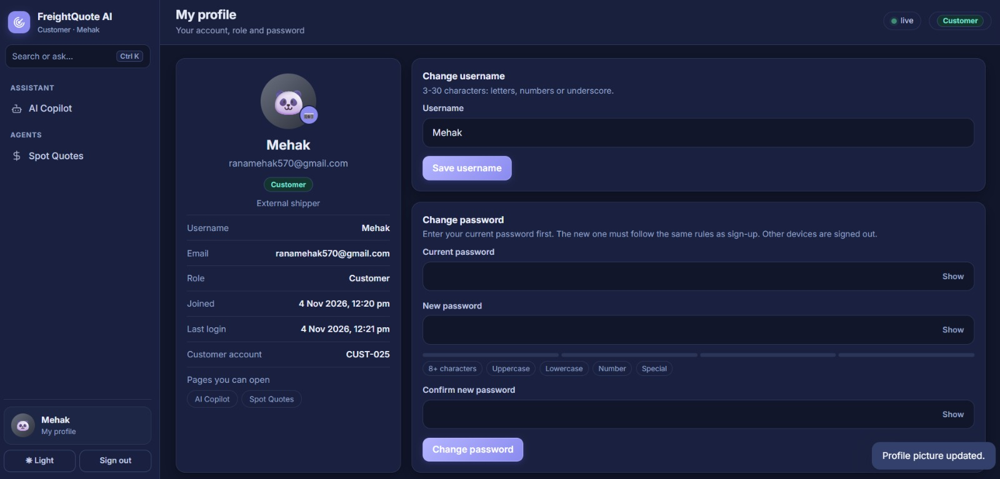

# FreightQuote AI · Milestone 2

**Infosys Springboard Internship 7.0 · Batch 4** · FastAPI · SQLite · JWT · bcrypt · Role-Based Access Control · Google Colab

FreightQuote AI is a multi-user freight platform. One sign-in page loads the access of the user's role automatically. It has AI agents, an SQL-exact AI Copilot (with voice input), live weather and customs checks, and an Admin dashboard.

## Team

| Role | Done by |
|---|---|
| Login page | **Mehak** |
| Freight Broker | **Mehak** |
| Operations Manager | **Bhavana** |
| Admin | **Bhavana** |
| Customer | **Bhargav** |
| Auditor | **Shahabuddin** |

**Team-03:** Mehak, Bhavana, Bhargav, Shahabuddin

## Features

- Single login for all roles (username or email + password), account lock after 5 wrong passwords, forgot password by e-mail OTP or security question
- Profile page with avatar or photo, change username and password
- Role-Based Access Control: each role sees only the pages it may open, enforced on the server
- AI Copilot with a mic button: ask by voice, get the answer (and hear it read aloud)
- Admin dashboard: active / inactive users, roles, lock and delete, activity log
- Admin can add a user or customer with a **temporary** password (must be changed at first sign-in) or a **permanent** password (the user can change it any time)

## How to run

1. Open the notebook in Google Colab and add the Colab Secrets (`JWT_SECRET`, `NGROK_AUTHTOKEN`, `EMAIL_ADDRESS`, `EMAIL_PASSWORD`, `ADMIN_PASSWORD`, optional `ADMIN_EMAIL`, `DEMO_PASSWORD`).
2. Run all cells from top to bottom.
3. Open the app link, sign in as the Admin and add users, or use the demo accounts.

## Roles, work done and screenshots

### Login page

**Done by:** Mehak

One sign-in page for every role: username or email + password, no role selection (the role is loaded automatically after sign-in). It also has sign up (new accounts are Customers), forgot password by e-mail OTP or security question, and account lock after 5 wrong passwords.

**1. Sign in page with the Welcome back form**

### Admin

**Done by:** Bhavana

Platform operator. Manages users, roles, active / inactive status, temporary or permanent passwords, locks and the activity log, and can open every page.

**Pages:** AI Copilot, Route AI, Spot Quotes, Carriers, Weather Risk, Margin, Customs, Run agents, Users (Admin dashboard), My profile

**1. Admin dashboard: all users with Active / Inactive status, role, account, password type and actions**

**2. My profile with profile picture, change username and change password**

**3. AI Copilot listening to a voice question and showing the SQL-exact answer**

### Operations Manager

**Done by:** Bhavana

Runs logistics. Watches routes, carriers, weather and customs, runs the agents and approves re-routes.

**Pages:** AI Copilot, Route AI, Carriers, Weather Risk, Customs, Run agents, My profile

**1. AI Copilot with the mic button (sidebar shows only this role's pages)**

**2. My profile with avatar and the pages this role can open**

### Freight Broker

**Done by:** Mehak

Sells and prices. Creates spot quotes, compares carriers and checks margins.

**Pages:** AI Copilot, Spot Quotes, Carriers, Margin, My profile

**1. My profile with avatar and the pages this role can open**

### Auditor

**Done by:** Shahabuddin

Compliance reviewer. Read-only access to every operational page and to the Copilot.

**Pages:** AI Copilot, Route AI, Spot Quotes, Carriers, Weather Risk, Margin, Customs, My profile

**1. Spot Quotes page (read only): quote decisions and margin chart**

**2. My profile with avatar and the pages this role can open**

### Customer

**Done by:** Bhargav

External shipper. Sees only their own quotes and shipments.

**Pages:** AI Copilot, Spot Quotes, My profile

**1. My profile with avatar, customer account id and only two pages in the sidebar**

---

**team-03 (Mehak,Bhavana, Bhargav, Shahabuddin)**
