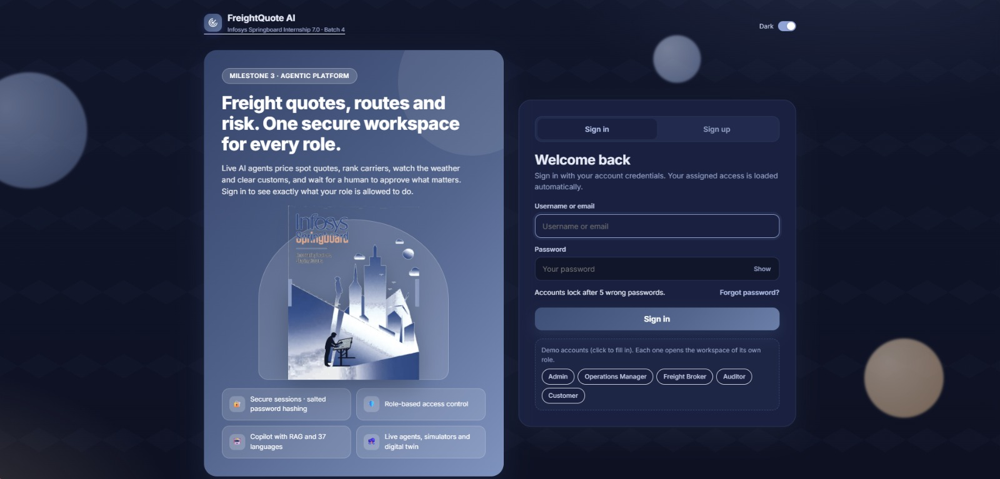
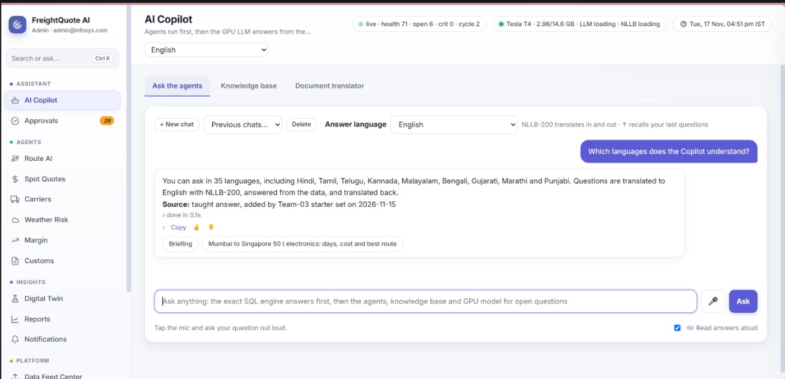
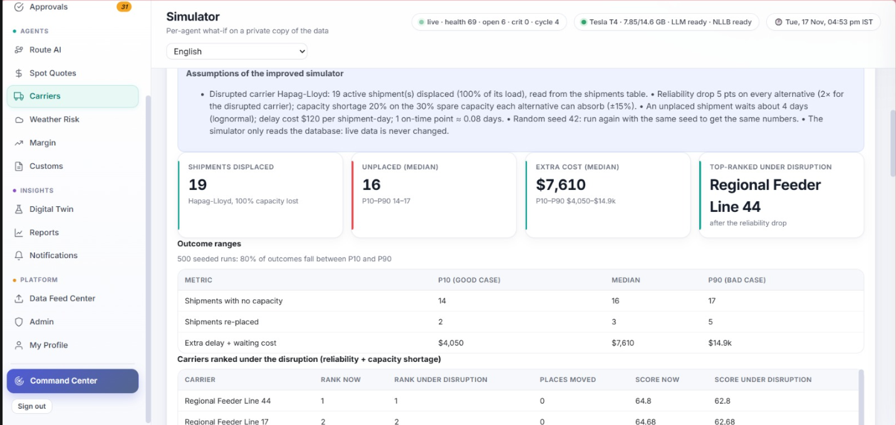

# 🚢 FreightQuote AI

### Agentic AI for Maritime Freight Pricing and Route Optimization
**Milestone 3 · Agentic Operations Platform** — Infosys Springboard Virtual Internship 7.0 · Batch 4 · Team-03

A multi-user, role-based freight platform built with **Python + FastAPI + SQLite + GPU models**. AI agents price spot quotes, rank carriers, watch weather and customs risk, and wait for a human to approve anything that matters. An **AI Copilot** answers questions about your data in plain English (and 35+ languages), and every answer is backed by an exact, visible SQL query.

This milestone builds on the secure sign-in from Milestone 1 and the role-based workspace from Milestone 2. Nobody reaches the agents, simulators or Copilot without signing in, and every role sees only the pages it is allowed to use.

---

## 📸 Screenshots

| Sign in | AI Copilot |
|---|---|
|  |  |

| Agent simulator | Admin → Teach Copilot |
|---|---|
|  | .png) |

---

## ✨ Features

- **Agent pipeline**: Route AI, Spot Quotes, Carriers, Weather Risk, Margin & Approvals, Customs and an anomaly watcher run on a background worker, raise tickets and wait for human approval
- **Spot quote engine**: ML price (RandomForest) + 12% fuel + port fees + 15% operating cost, target margin around 20%. Quotes above $50,000 or below 10% margin need an approver
- **Real sea routing**: ocean mask from the world coastline, real canals and straits (Suez, Panama, Malacca, Hormuz and more) and Dijkstra routing over a 1° water grid
- **SQL-exact AI Copilot**: questions become read-only, whitelisted SQL, so the language model never invents a number
- **Teach Copilot**: Admins find unanswered questions, teach the correct answer, and the Copilot answers it (and rephrased versions) from then on
- **Hybrid RAG knowledge base**: BM25 + dense embeddings fused with Reciprocal Rank Fusion, then a cross-encoder reranker, with citations
- **35+ languages**: questions and answers translated on the GPU with Meta NLLB-200
- **Simulators with Monte Carlo**: assumptions shown, fixed random seed, and 10th–90th percentile ranges from 500 runs
- **Digital Twin**: stack several shocks, see the money impact, rank mitigations and send a chosen one to the approval queue (live data is never changed)
- **Role-based access control** in the UI and on the API
- **Admin console**: runtime, GPU and models, decisions, users and access, audit log, Copilot insights, system check and data governance
- **Data Feed Center**: upload, folder inbox or URL feeds are validated, auto-mapped and loaded, then the agents re-run
- **Reports**: print-ready PDFs and CSV exports
- **Audit trail** for every sensitive action
- **Light / Dark mode** and a responsive layout

---

## 🧰 Tech Stack

| Technology | Purpose |
|---|---|
| Python | Main language |
| FastAPI + uvicorn | Backend API |
| SQLite (`sqlite3`) | Database (users, tickets, quotes, chats, audit log) |
| Qwen2.5 Instruct | LLM that explains Copilot answers |
| NLLB-200 (distilled 600M) | Translation in 35+ languages |
| sentence-transformers | Embeddings and reranking for RAG |
| scikit-learn, Prophet | Pricing and trend models |
| LangGraph | Agent flow |
| PBKDF2 + PyJWT | Password hashing and sessions |
| ECharts, Leaflet, TopoJSON | Charts and maps (bundled, no CDN at runtime) |
| reportlab, matplotlib | PDF reports |
| pyngrok | Public URL when running on Google Colab |
| Google Colab (T4 GPU) | Runtime |

---

## 🗂️ Project Structure

The whole project lives in one notebook. Each `%%writefile` cell creates a file in `/content/app` when you run it.

```
.
├── Milestone3.ipynb        # Notebook: installs, all modules, launcher
├── README.md
├── docs/                   # Screenshots
└── app/ (generated)
    ├── server.py           # FastAPI routes, auth guards, page dispatch
    ├── worker.py           # Simulator, agent cycles, escalation
    ├── authx.py            # Passwords, lockout, sessions, reset
    ├── hardening.py        # Rate limits, security headers, error handler
    ├── domain_freight.py   # Freight agents, ML pricing, rerouting
    ├── live_engine.py      # Shared live agent runtime
    ├── live_rbac.py        # Action-level capabilities
    ├── seanav.py           # Sea routing
    ├── sim_plus.py, sim_fq.py, mc.py, mc_sims.py   # Simulators and Monte Carlo
    ├── twin.py, twin2.py   # Digital Twin
    ├── copilot_pro.py      # Copilot layers and INTENTS
    ├── qa.py, analyst.py   # Exact SQL engine and explanations
    ├── rag.py, kb_pack.py  # Hybrid RAG and sample policy pack
    ├── gpu.py              # Qwen, NLLB and embedder loading
    ├── data_feeder.py      # Upload / folder / URL feeds
    ├── reports.py          # PDF and CSV reports
    ├── privacy.py          # Retention, masking, export / erase
    ├── persist.py          # Google Drive backup of the database
    ├── views_*.py, blocks.py   # Server-driven pages and UI blocks
    ├── taught_seed.csv     # Starter taught questions
    └── static/             # index.html, style.css, app.js, vendor libraries
```

---

## 👥 Roles and Page Access

| Role | Copilot | Route | Quotes | Carriers | Weather | Margin | Customs | Run agents | Users |
|---|:-:|:-:|:-:|:-:|:-:|:-:|:-:|:-:|:-:|
| Admin | ✅ | ✅ | ✅ | ✅ | ✅ | ✅ | ✅ | ✅ | ✅ |
| Operations Manager | ✅ | ✅ | ❌ | ✅ | ✅ | ❌ | ✅ | ✅ | ❌ |
| Freight Broker | ✅ | ❌ | ✅ | ✅ | ❌ | ✅ | ❌ | ❌ | ❌ |
| Auditor | ✅ | ✅ | ✅ | ✅ | ✅ | ✅ | ✅ | ❌ | ❌ |
| Customer | ✅ | ❌ | ✅ | ❌ | ❌ | ❌ | ❌ | ❌ | ❌ |

- Sign-up offers **Operations Manager, Freight Broker, Auditor and Customer** only. Admin accounts are seeded, never self-registered.
- The role is read from the account after sign-in. Nobody picks a role at login.
- Admins cannot lock, unlock or deactivate admin accounts, including their own.
- A page a role is not allowed to open returns **403 Refused**, even if the API is called directly.

---

## 🛡️ Security Highlights

- **PBKDF2** password hashing with a salt per password (never plain text)
- **Progressive lockout** after repeated wrong passwords (5 min, then 15 min, then permanent)
- **JWT sessions** in HttpOnly cookies
- **Security-question reset** and optional e-mail OTP
- **Rate limits** on auth routes, **security headers** (CSP, frame, permissions) and request IDs with a JSON access log
- **Read-only, parameterised SQL** for the Copilot
- **Global error handler** that never leaks tracebacks
- **Audit log** for sensitive actions, including blocked attempts
- **Privacy tools**: retention, PII inventory, masking, data export and erase
- **No hard-coded secrets**: everything comes from Colab Secrets or environment variables
- **IST timestamps** across the app

---

## 🔄 How It Works

**Sign in** → check lockout → verify the password hash → create a JWT session → the server reads your role and shows only your pages.

**Agents** → the background worker runs the agent cycles → agents raise tickets → a human approves or rejects → the audit log records it.

**Ask the Copilot** → typo repair and follow-up memory → exact SQL engine answers first → agents, knowledge base and GPU model help only for open questions → the SQL behind the answer is shown.

**Teach the Copilot** → Admin tests a list of questions → unanswered ones go to a backlog → Admin writes the correct answer and keywords → the Copilot answers it from then on.

**Simulate** → the simulator reads start values from the database → runs 500 seeded Monte Carlo runs → shows assumptions and P10–P90 ranges → live data is never changed.

---

## 🚀 Getting Started (Google Colab)

1. **Upload** `Milestone3.ipynb` to [Google Colab](https://colab.research.google.com) and choose **Runtime → Change runtime type → T4 GPU**.
2. *(Optional)* Open the 🔑 **Secrets** panel and add the secrets below. Turn **Notebook access ON** for each one.
3. **Run all cells from top to bottom.** The last cells start the server and print the link.
4. Open the link printed in the output (Colab's own link, or the ngrok URL if you set a token).
5. Sign in with the admin account (demo mode):

| Field | Value |
|---|---|
| E-mail | `admin@infosys.com` |
| Password | `Admin@123` (or your `ADMIN_PASSWORD` secret) |

The sign-in card shows **Starting up** while the models load on the GPU. You can already sign in during that time.

### Secrets

| Name | Required | Description |
|---|---|---|
| `HF_TOKEN` | optional | Hugging Face token for faster model downloads |
| `JWT_SECRET_KEY` | optional | Session signing key (a random one is generated if not set) |
| `ADMIN_EMAIL_ID`, `ADMIN_PASSWORD` | optional | Seeded admin account |
| `DEMO_MODE` | optional | `1` (default) seeds demo accounts, `0` creates only the admin |
| `LLM_MODEL`, `NLLB_MODEL` | optional | Override the default models |
| `NGROK_AUTHTOKEN` | optional | Free token from [ngrok](https://dashboard.ngrok.com/get-started/your-authtoken) for a public link |
| `EMAIL_ID`, `EMAIL_PASSWORD`, `ALERT_EMAIL_TO` | optional | Gmail App Password for OTP and alerts |

### Keeping your data

With `PERSIST = True` in the launcher cell, the database (users, tickets, approvals and saved Copilot chats) is backed up to `MyDrive/freight_quote_data/db` every few minutes and restored after a runtime reset.

### Running locally instead

```bash
pip install fastapi "uvicorn[standard]" python-multipart pyjwt pandas numpy scikit-learn transformers sentence-transformers
cd app
uvicorn server:app --host 0.0.0.0 --port 8000
```

Run the notebook's `%%writefile` cells once first so the `app/` folder exists. A GPU is strongly recommended for the Copilot models.

---

## 🧑‍🤝‍🧑 Team and Work Distribution

| Member | Owner | Area | Task |
|---|---|---|---|
| Member 1 | **Gowri Alekya** | RAG & Knowledge Base | Task 1 |
| Member 2 | **Mehak Rana** | AI Copilot | Tasks 2 & 3 |
| Member 3 | **Ankit Kumar** | Agent Simulators | Task 4 |
| Member 4 | **Smruti** | Application Integration & Security | Task 5 |

**Task 1 · RAG & Knowledge Base** — Collected 150+ websites and PDF sources (Incoterms, customs, HS codes, shipping documents), ran the RAG Builder notebook, generated the FAISS and BM25 indexes, integrated the knowledge base and verified the chunks in Admin → System Check.

**Tasks 2 & 3 · AI Copilot** — Found 50+ unanswered questions, prepared `taught_questions.csv`, taught the Copilot through Admin, improved `INTENTS` in `copilot_pro.py`, added synonyms in `qa.py` and compared the answer rate before and after.

| Measure | Before | After |
|---|:-:|:-:|
| Questions tested | *fill in* | *fill in* |
| Answered | *fill in* | *fill in* |
| Answer rate | *fill in %* | *fill in %* |

**Task 4 · Agent Simulators** — Improved the Route, Quote, Carrier, Weather and Customs simulators with assumptions, 10th–90th percentile ranges and a random seed, with before and after screenshots.

**Task 5 · Application Integration & Security** — Integrated sign-in with JWT, the profile page, role-based access control, the Admin dashboard and the 403 Refused demo, with IST timestamps and no hard-coded secrets.

---

## ⚠️ Known Limitations

- A **T4 GPU** is needed for the Copilot models. Without it they fall back to CPU or stay unloaded.
- The first start takes a few minutes while models download and load.
- On Colab the database is lost when the runtime resets unless `PERSIST` (Drive backup) is on.
- SQLite and a single server process suit a demo, not heavy production traffic.
- The sample policy documents in the knowledge base are illustrative text. Replace them with your own documents.
- Sea-route coordinates are approximate. Load UN/LOCODE or World Port Index data through the Data Feed Center for real use.
- Demo accounts are for the internship demo. Set `DEMO_MODE=0` and a strong `ADMIN_PASSWORD` before sharing the link.
- This is an internship project. **Do not use real sensitive accounts or production data.**

## 🔭 Future Improvements

Cloud database, 2FA, e-mail verification at sign-up, IP-based rate limiting, live vessel and weather feeds, and a larger verified knowledge base.

---

## 👤 Author

Mehak Rana (Member 2, AI Copilot) with Team-04 — Infosys Springboard Virtual Internship 2026

**Mentor:** *add name*

*Built as part of the Infosys Springboard Virtual Internship project.*
